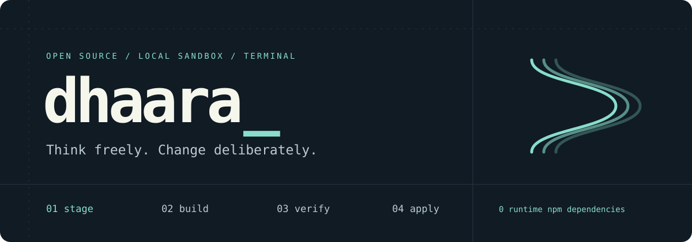

<p align="center"></p>

<p align="center">
  <a href="https://github.com/divyanshu-iitian/Divyansharness/actions/workflows/ci.yml"></a>
  <a href="LICENSE"></a>
  
  
  <a href="https://github.com/divyanshu-iitian/Divyansharness/releases"></a>
</p>

**Dhaara is a small, open-source terminal coding harness.** Give it a task. It works
in a staged copy, runs commands in local Docker, checks its work, and leaves you a
diff to apply. The native runtime has **zero npm dependencies**.

**Experimental v0.1.** Model quality still matters. This is not a benchmark-proven
replacement for OpenCode, DeepSeek Harness, or your code review.

```text
your task → isolated workspace → tools → verification → diff → you apply
               original files stay unchanged until that last step
```

[Quick start](#quick-start) · [Free models](#choose-your-model) · [Architecture](docs/ARCHITECTURE.md) · [Evidence](docs/EVALUATION.md) · [Build log](WORKLOG.md)

## Why another harness?

A model predicts what to do. A **harness** supplies the loop around it: instructions,
tools, context, execution, budgets, state and a definition of “done.” Dhaara keeps
that machinery small enough to read and explicit enough to inspect.

- **Your working tree is yours.** Bounded snapshots, reviewable diffs, and apply that
  refuses conflicts with changes you made while the agent worked.
- **Completion needs evidence.** The harness reruns configured checks. A model's
  “done” message cannot turn failing tests into a verified result.
- **Edits carry a version.** Reads return line numbers and a SHA-256. Existing-file
  edits must match that hash; stale edits fail without changing the file.
- **Local isolation is real.** Disposable Linux containers, offline by default,
  readonly root, dropped capabilities and CPU/RAM/PID limits. No host-shell fallback.
- **Free routes are explicit.** Local Ollama, live OpenRouter free models, or the
  official OpenCode CLI bridge. Native free mode never selects a paid fallback.
- **Work survives the terminal.** Saved sessions, tool records, checkpoints,
  bounded context, cancellation cleanup and resumable native failures.

## Quick start

Install [Node.js 22 or 24 LTS](https://nodejs.org/) and a running
[Docker Linux engine](https://docs.docker.com/get-started/get-docker/).
Windows/macOS users can use Docker Desktop. No cloud sandbox subscription needed.

```sh
npm install -g https://github.com/divyanshu-iitian/Divyansharness/releases/download/v0.1.0/divyanshu-iitian-dhaara-0.1.0.tgz
dhaara sandbox setup
dhaara doctor
dhaara demo
```

`demo` needs **no model or API key**. It uses a scripted tool sequence against real
Docker: fix a tiny bug, pass `node --test`, produce a reviewable session.
It demonstrates the machinery; it is not an LLM evaluation.

From source:

```sh
git clone https://github.com/divyanshu-iitian/Divyansharness.git
cd Divyansharness
npm install -g .
```

## Choose your model

| Route | What you need | Agent loop | Cost boundary |
|---|---|---|---|
| **Ollama** | Local model with tool calling | Dhaara on your computer | No inference API bill; hardware costs separate |
| **OpenRouter** | Your `OPENROUTER_API_KEY` | Dhaara on your computer | Live zero-price `:free` tool models; no paid fallback |
| **OpenCode bridge** | Optional bridge image; network | Official OpenCode CLI in Docker | Currently free model selected; provider limits apply |
| **Compatible API** | URL, model, optional `DHAARA_API_KEY` | Dhaara on your computer | Provider-specific; may cost money |

### OpenCode free models

OpenCode currently restricts free-tier chat to its own client. Dhaara integrates
the **official CLI** in a staged container; it does not impersonate that client.
See [OpenCode's inference policy](https://opencode.ai/docs/console/api/inference/).

```sh
dhaara sandbox setup --bridge
dhaara models --provider opencode
dhaara bridge "Fix the failing tests" --network --model big-pickle --verify "npm test"
```

Choose from the live list; names and availability change. `big-pickle` passed our
tiny-task smoke check. Set your own `OPENCODE_API_KEY` if your account requires it.
Free access is not unlimited or guaranteed.

The bridge grants outbound access to the whole container. OpenCode owns its loop;
Dhaara supplies staging, container limits, independent **offline** verification
and conflict-checked apply. It uses a whole-run timeout, not native turn/token
budgets. Native `resume` does not resume OpenCode sessions.

### Local Ollama

Start [Ollama](https://docs.ollama.com/quickstart), install a tool-capable local model
that fits your hardware, then use its exact name:

```sh
dhaara models --provider ollama
dhaara run "Fix the failing tests" --provider ollama --model YOUR_LOCAL_MODEL --verify "npm test"
```

Ollama is the default provider at `http://localhost:11434/v1`. Select a model
explicitly: automatic selection uses the first catalog entry, not a memory-aware
recommendation. Tiny models can fail tool use; our 1.5B smoke run failed honestly.
See [published results](docs/EVALUATION.md).

### OpenRouter free models

Set `OPENROUTER_API_KEY` in your shell: `export OPENROUTER_API_KEY=...` on bash/zsh,
or `$env:OPENROUTER_API_KEY='...'` in PowerShell. Then:

```sh
dhaara models --provider openrouter
dhaara run "Fix the failing tests" --provider openrouter --model MODEL_FROM_THE_LIST --verify "npm test"
```

Discovery requires zero input/output prices and tool support. Requests also set
zero maximum provider prices. Rate limits return an error after bounded retries;
there is no silent paid-model switch. Live inference was not performed for this
route; discovery and protocol behavior are tested.

### Other providers

```sh
dhaara run "Explain this module" --provider compatible --base-url https://YOUR_PROVIDER/v1 --model YOUR_MODEL
```

Set `DHAARA_API_KEY` if needed. Supports streaming Chat Completions with tools;
native Responses, Anthropic and Gemini protocols are not yet implemented.

## Work, review, apply

```sh
dhaara plan "Find the cause of the failing tests" --model YOUR_LOCAL_MODEL
dhaara run "Repair the failing parser" --model YOUR_LOCAL_MODEL --verify "npm test"
dhaara diff SESSION_ID
dhaara show SESSION_ID
dhaara apply SESSION_ID
```

The run prints its session ID. `apply` requires a verified, unchanged staged tree
and checks original-file conflicts. Without a verifier, completion is `needs-review`.
Run `dhaara verify SESSION_ID --verify "command"`, or use the explicit
`--allow-unverified` apply override after your own review.

```sh
dhaara resume SESSION_ID "Continue from the failing check" --model YOUR_LOCAL_MODEL
dhaara sessions
dhaara run "Fix the parser" --max-turns 12 --max-tokens 60000 --timeout 300 --json
```

Run `dhaara --model YOUR_LOCAL_MODEL` for the terminal conversation. Commands:
`/plan`, `/build`, `/new`, `/models`, `/diff`, `/status`, `/help`, `/exit`.
`Ctrl+C` cancels active work. `--json` emits newline-delimited events for scripting.

## Small core, honest resource costs

About **65 KB of runtime source**, seven tools, zero runtime npm dependencies.
Two seven-run Windows batches observed **70–107 ms median** CLI startup and
**49–57 MB RSS** after importing the CLI. These are machine-specific observations;
reproduce with `npm run bench`. [Method and environment](docs/EVALUATION.md).

Docker and model inference are **additional** costs. Native command containers
default to 512 MiB RAM, one CPU, 128 PIDs and 128 MiB temporary storage. The optional
bridge gets 1 GiB RAM. The default Node Alpine image does not include Python or your
project's dependencies. Prepare a custom `--image` when needed.

Snapshots omit `.git`, dependencies, known secret paths and symlinks. Limits:
5,000 files, 64 MiB total, 1 MiB per file. Add `.dhaaraignore` exclusions for larger
repos. See [usage and troubleshooting](docs/USAGE.md).

## Evidence, not leaderboard promises

| Check | Observed result |
|---|---|
| Unit/protocol tests | Stale edits, conflicts, traversal, stream truncation, recovery, free routing, failure gating |
| Cross-platform CI | Node 22/24 on Linux, macOS and Windows |
| Real Docker tests | Offline networking, readonly root/plan mount, host-secret exclusion, timeout/abort cleanup |
| Live OpenCode / big-pickle smoke | Passed visible and controller-owned probes; fixture tests/original source unchanged |
| Native Ollama / qwen2.5:1.5b | Failed; stopped without accepting completion |
| Native Ollama / qwen2.5:3b | Model load failed with CUDA out-of-memory on this machine |

One tiny task is not SWE-bench or Terminal-Bench. No superiority over OpenCode or
DeepSeek Harness has been established. The differentiator is a readable small
runtime combining staged changes, explicit free routes and verification receipts.
Mature harnesses offer broader integrations; v0.1 does not include MCP, LSP,
multi-agent orchestration or a full-screen TUI.

```sh
npm test
npm run check
npm run test:sandbox
npm run eval:smoke -- --bridge --network --model big-pickle
```

[Evaluation](docs/EVALUATION.md) · [Research decisions](docs/RESEARCH.md) · [Architecture](docs/ARCHITECTURE.md) · [Security](SECURITY.md)

## Build it in the open

Every building block was committed and pushed separately. Follow the
[build log](WORKLOG.md) and [commit history](https://github.com/divyanshu-iitian/Divyansharness/commits/main/).

Useful contributions: reproduce a failure, add a compact evaluation task, improve
small-model tool use, or harden a boundary with a regression test.
[Contributing](CONTRIBUTING.md) · [Roadmap](docs/ROADMAP.md).

Inspired by Pi, Oh My Pi, OpenCode, DeepSeek Harness, Deep Agents and OpenHands;
independently implemented here. References are in the [research notes](docs/RESEARCH.md).

**MIT licensed.** Built by [Divyanshu](https://github.com/divyanshu-iitian).
If this workflow helps you, share a reproducible result or star the repository.
