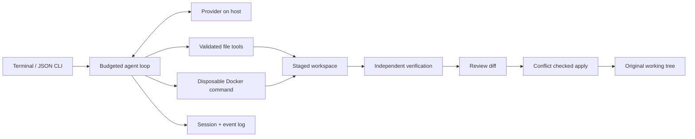

# A small runtime with an explicit boundary

## Modules

| Module | Responsibility |
|---|---|
| `cli.js`, `ui.js` | Terminal conversation, explicit commands, safe output, JSON events |
| `agent.js` | Bounded loop, context selection, action recovery, completion gating |
| `providers.js` | Local/free catalog discovery, native SSE Chat Completions |
| `tools.js` | Small tool schema set, strict argument checks, verifier ownership |
| `workspace.js` | Snapshot, safe paths, hashed range edits, diff, apply conflicts |
| `sandbox.js` | Docker lifecycle, resource policy, cleanup after cancellation |
| `session.js` | Atomic session JSON, append-only event log, exclusive process lock |
| `bridge.js` | Optional official OpenCode CLI inside a staged Docker workspace |

## Deliberate choices

**Copy first.** Reading the repository creates a bounded snapshot. The agent can
experiment without changing the original. Dependency directories and known secret
paths are excluded. Default limits are 5,000 files, 64 MiB total, 1 MiB per file.
`.dhaaraignore` supports simple `*` and `?` path patterns, not full gitignore syntax.
Ignored files aren't copied or deleted by apply. Changes to ignore rules inside
the stage cannot hide edits from the reviewer.

**Versioned edits.** A read returns a complete SHA-256 and line numbers. A write to
an existing file must carry that SHA-256. Multiple ranges are validated together
and applied in reverse line order to a temporary file, then renamed. This avoids
asking the model to reproduce the old text, while rejecting stale reads. Hashes
detect stale content; they do not prove the intended change is correct.

**Small context.** Full transcripts remain on disk. Requests keep recent complete
tool exchanges, the original task and explicit checkpoint notes. Older tool
outputs are bounded; no separate LLM summarizer or vector database is required.
Re-reading is the recovery mechanism when exact earlier details are needed.

**One bounded process per command.** Shell state does not persist, filesystem
state does. Commands have timeouts. Cancellation removes the container, because
killing only the Docker client leaves container processes alive.

**Completion is a proposal.** `finish` triggers configured verification. Failing
checks return to the agent. Without checks, the result is `needs-review`, never
`verified`. A verification receipt includes the staged tree fingerprint, commands,
exit codes and durations; later edits invalidate it.

**No replay illusion.** A tool call is recorded before execution. Resume supplies
an explicit interruption result for incomplete calls. The next turn inspects the
workspace rather than assuming the action never ran. This is not exactly-once
execution; external effects can be ambiguous after a crash.

## Free model access

Ollama uses its localhost Chat Completions interface. OpenRouter models must exist
in the live `:free` catalog, have zero input/output prices and support tools. Rate
limits are bounded-retried without switching to paid models. The first release
supports Chat Completions providers, not arbitrary Responses/Anthropic APIs.

OpenCode free models currently require its official client. The bridge is an
explicitly separate backend: OpenCode owns its model loop; Dhaara owns staging,
outer container limits, verification and apply. It is not a claim that Dhaara's
native loop can directly use restricted OpenCode APIs.
